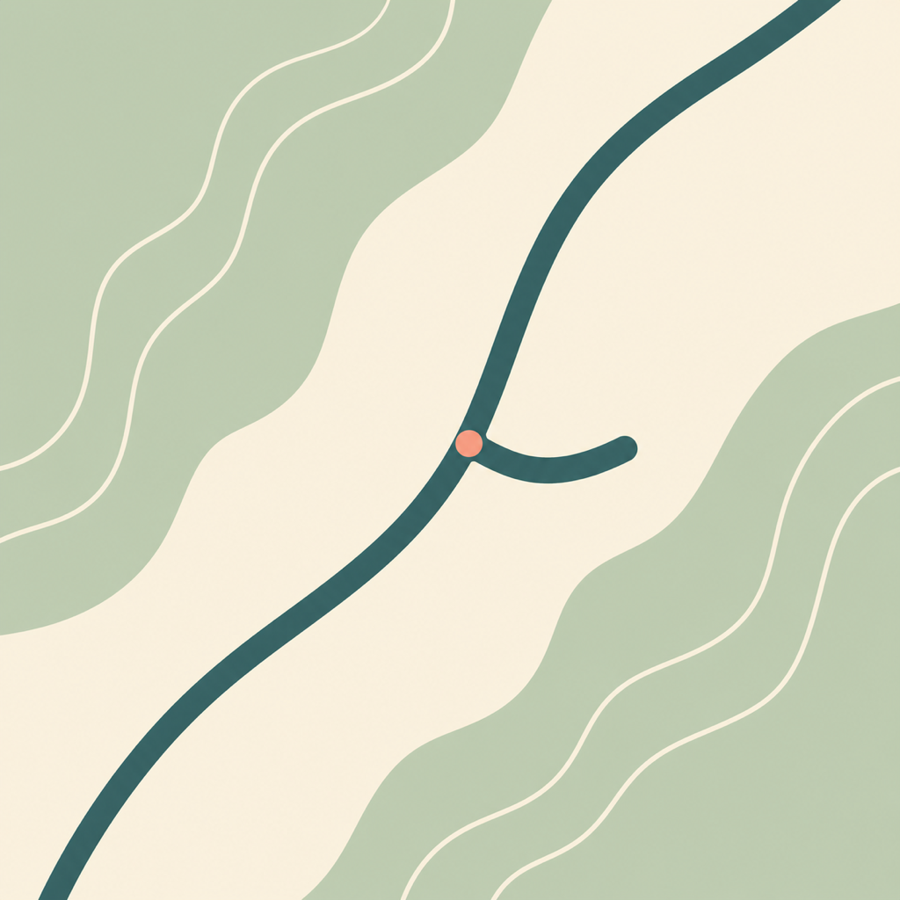

<p align="center">
  
</p>

<h1 align="center">凤凰山谷</h1>

<p align="center">
  一款面向 iPad 的路网规划沙盒，用 Apple Pencil 在地形上绘制、审查和整理交通地图。
</p>

<p align="center">
  <a href="README.md">English README</a>
</p>

## 概览

凤凰山谷是一个原生 iPadOS 规划游戏原型，核心体验是在随机生成的山地、水域、谷地和海岸地形上绘制道路，并根据地形与既有路网判断桥梁、隧道、坡度和交叉关系。

当前项目仍是本地原型，尚不是 App Store 正式发布版本。应用目标平台为 iPadOS 17 或更高版本，核心几何、地形和路网规划逻辑以 Swift Package 形式组织，可独立测试。


## 核心体验

- 用 Apple Pencil 绘制高速、主干道、街道和铁路。
- 用触控平移、缩放地形画布，保持 Pencil 作为主要绘路输入。
- 支持地面、高架、隧道、桥梁、匝道和显式立交结构。
- 绘路后审查桥梁、隧道、坡度、水域和道路交叉建议，再决定是否应用。
- 支持道路选择、框选、移动、类型修改、撤销、重做和局部擦除。
- 用分组管理多张地图，支持预览、重命名、复制、移动和删除。
- 提供地形、规划、墨线、海岸蓝、午夜、森林等地图主题。
- 可导出 PNG、PDF、SVG 或 GeoJSON。

## iPadOS 设计

凤凰山谷采用 Apple 平台原生交互，而不是把桌面界面搬到 iPad 上：

- 使用 `NavigationSplitView` 组织地图库和画布。
- 可拖动的 Pencil 笔盒支持停靠在底部、左侧或右侧。
- 外观、导出、编辑和项目管理使用系统工具栏与 Popover。
- App Shortcuts 支持直接进入画布并选择道路工具，或创建随机地图。
- 项目以本地优先方式保存，App target 中已接入可选 iCloud 文档容器。

## 工程模型

项目不会把笔迹当成简单线条处理。核心模型会维护道路源、拓扑节点与边、有向交通规则、结构转换、桥梁与隧道工程资产，以及施工可行性诊断。地形生成使用可复现的随机种子，便于保存、测试和回放。

Swift Package 中已有针对笔迹处理、拓扑、地形生成、桥隧规划、匝道规划、交通规则、地图导出、图层可见性和旧项目兼容性的测试。

## 仓库结构

```text
PhoenixValleyApp/              原生 iPadOS App target
Sources/PhoenixValleyCore/     道路、地形、拓扑、导出和规划逻辑
Tests/PhoenixValleyCoreTests/  核心单元测试
Tests/PhoenixValleyCoreSmoke/  冒烟测试入口
Docs/                          发布、隐私和 App Store 资料
```

## 环境要求

- 安装完整 Xcode 的 macOS
- iPadOS 17 或更高版本目标设备/模拟器
- Xcode 提供的 Swift 6 工具链
- 在实体 iPad 安装时需要 Apple Developer 签名配置

## 运行

1. 用 Xcode 打开 `PhoenixValley.xcodeproj`。
2. 选择 `PhoenixValley` scheme。
3. 选择 iPad Simulator 或已连接的 iPad。
4. 如需安装到实体设备，在 Signing & Capabilities 中设置 Development Team。
5. 构建并运行。

## 测试

使用匹配的 Xcode Swift 工具链运行核心测试：

```bash
swift test
```

## 状态

凤凰山谷仍在开发中。当前原型已具备可用画布、随机地形、拓扑感知道路编辑、桥隧建议、立交编辑、交通规则、项目持久化、地图导出和隐私文档。后续仍需完成实体 iPad 与 Apple Pencil 测试、更丰富的地形系统、Apple Pencil 高级手势、自定义样式、交通模拟和正式 App Store 发布流程。
